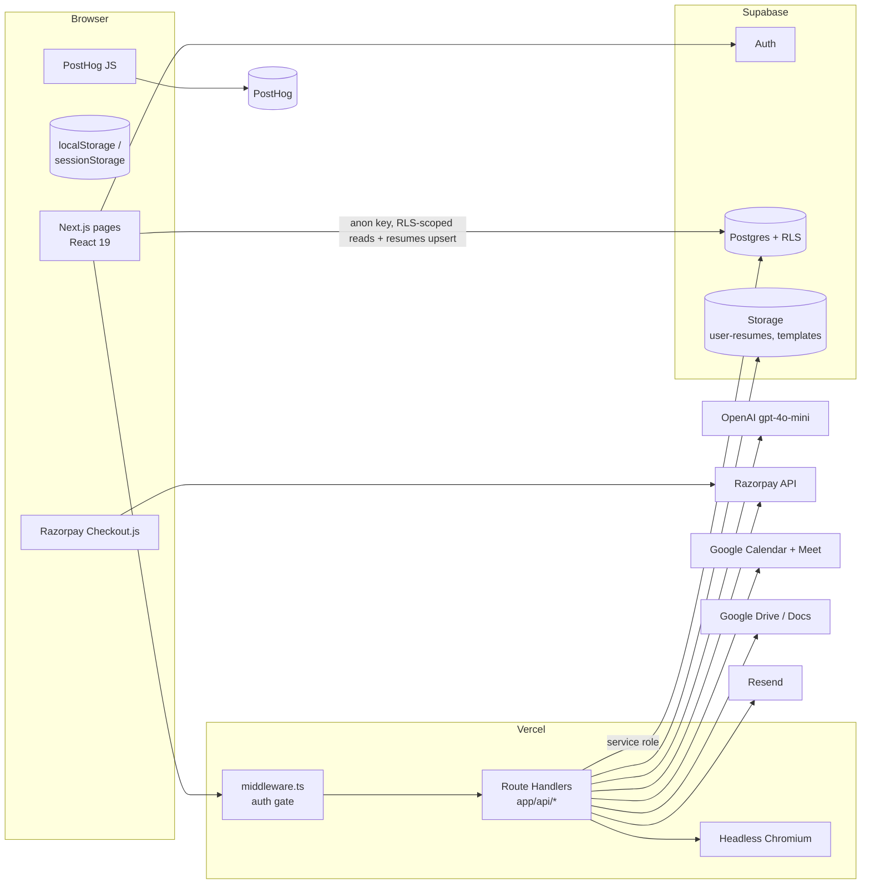
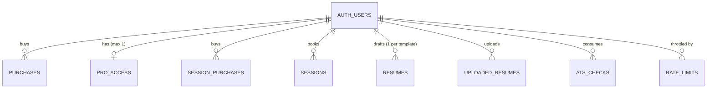

# Resume Expert — Product & Technical Reference

> **Status:** Authoritative reference for the `resume-marketplace` codebase.
> **Last verified against code:** 18 Oct 2026 (commit `d589ddc`).
> **Rule of thumb:** where this document and the code disagree, the code wins. Update this file in the same PR as any change to pricing, entitlements, schema, or API contracts.

---

## Contents

1. [Product Description](#1-product-description)
2. [Target User Segments](#2-target-user-segments)
3. [Key Benefits](#3-key-benefits)
4. [Pricing & Entitlements](#4-pricing--entitlements)
5. [Market Positioning](#5-market-positioning)
6. [System Architecture](#6-system-architecture)
7. [Database](#7-database)
8. [API Reference](#8-api-reference)
9. [Core Flows](#9-core-flows)
10. [AI Layer](#10-ai-layer)
11. [Third-Party Integrations](#11-third-party-integrations)
12. [Templates & Rendering](#12-templates--rendering)
13. [Client-Side State](#13-client-side-state)
14. [Analytics](#14-analytics)
15. [Security Posture](#15-security-posture)
16. [Configuration](#16-configuration)
17. [Tooling, QA & Operations](#17-tooling-qa--operations)
18. [Known Gaps & Risks](#18-known-gaps--risks)

---

## 1. Product Description

Resume Expert is an AI-powered resume platform built for Indian job seekers. It puts three things in one affordable product: **resume scoring**, **AI-driven rewriting** and **consultation with a human expert**.

The problem it solves is hidden friction in the job search. Most candidates don't know why their resume gets no responses. The file might be unreadable to an Applicant Tracking System (ATS), the language might be too generic, or the format might be outdated. Resume Expert shows that friction, puts a number on it, and gives users concrete tools to fix it.

### What users can do on the platform

**Score their existing resume.** Users upload a PDF or paste their resume text. The platform extracts the text and sends it to OpenAI `gpt-4o-mini` with a structured analysis prompt. It returns an overall score plus two axes: an **ATS Score** (how well the resume survives automated filtering) and a **Recruiter Score** (how compelling it reads to a human reviewer). Users also see five section scores (keywords, formatting, contact info, achievements, and relevance to the job), 3–5 specific issues, up to 10 missing keywords, and 2–3 suggested rewrites for their weakest bullets. Pasting a job description is optional; it enables the relevance score and keywords specific to that job.

**Get an AI rewrite.** The AI rewrite is a Pro feature. It takes the original resume, the ATS findings and an optional job description, then makes a second `gpt-4o-mini` call to extract and rewrite the resume into structured data. A third call scores the rewritten version. The before/after view (`/ats-rewrite`) shows the score change, comparisons for the summary and each bullet, and a list of key changes. Users can save the rewrite to their dashboard or download it as a PDF.

**Build a resume from scratch.** The builder (`/builder/[templateId]`) takes users through personal details, experience with bullet points, education, skills (flat or grouped), and awards. A live template preview updates as they type. Drafts autosave to the user's account for each template. A "Check ATS" action renders the draft to PDF and sends it straight to the scorer.

**Edit in Google Docs.** This is a Pro feature. An uploaded resume, or a draft from the builder, is converted into a Google Doc and opens in a new tab.

**Book a 1:1 expert session.** Pro includes one 30-minute session. Users can buy more sessions. Booking shows live availability from the expert's Google Calendar over the next 14 days, and the booking itself creates a Google Calendar event with a Google Meet link.

**Buy individual templates.** Users who don't want Pro can buy a single template. That unlocks the pre-rendered PDF for the template in every colour variant.

---

## 2. Target User Segments

The platform targets four groups in the Indian professional job market.

### Career Starters (0–2 years experience)
First-time job seekers and recent graduates who have never built a professional resume. They need structure, a good-looking template, and confidence that their resume meets recruiters' basic expectations. They usually start with the free ATS checker and may buy a single template.

### Active Job Seekers (2–5 years experience)
Mid-career professionals who are actively applying. They have a resume, but it underperforms: it's too generic, the bullets describe tasks rather than outcomes, and the keywords don't match the job description. The AI rewrite and unlimited ATS checks (Pro) address this directly.

### Career Changers
Professionals moving into a new domain or function. Their resume is accurate but framed badly for the target role. They gain most from combining the AI rewrite with a job description, then using the expert session to check the story they're telling.

### Senior Professionals (5+ years experience)
Experienced candidates going for senior or leadership roles. They care about presentation and polish. The Executive template and the expert session are what draw them; the AI rewrite gives a second opinion before important applications.

---

## 3. Key Benefits

**Numbers instead of vague advice.** Most free tools give generic tips like "use action verbs". Resume Expert gives scores from 0 to 100, broken down by section, and names specific issues. Users know exactly what to fix and can check the fix by running the analysis again.

**An AI rewrite that keeps the user's voice.** The rewrite starts from the user's own content, not a blank page. The prompt enforces strict rules: keep every section, keep the same number of bullets, and invent no metrics, skills or achievements. It improves wording and keyword coverage without throwing away the user's real experience.

**Validation from a human expert.** The 1:1 session sets the product apart. AI isn't presented as a replacement for an expert's judgement. It does the preparation, so the session can focus on strategy rather than basic fixes.

**One-time pricing removes the commitment barrier.** Pro costs ₹999 once, for life, with no renewal. Subscription competitors such as Enhancv, Zety and Resume.io charge $15–25 a month. A job search is a one-off event, and a one-off payment is the more honest model for it.

**Built for India.** Templates, INR pricing, IST business hours and the expert's market knowledge are designed for Indian hiring, not adapted from a Western product.

---

## 4. Pricing & Entitlements

All amounts are stored and charged in **paise** (₹1 = 100 paise).

| SKU | Price | Source of truth | Grants | Recorded in |
|---|---|---|---|---|
| Free | ₹0 | — | 5 ATS checks **per account, for life** (not per month) | `ats_checks` (one row per check) |
| Single template | ₹99 – ₹499 | `lib/templates.ts` → `price_inr` | Download of that template's pre-rendered PDF (all colours); builder download for that template | `purchases` |
| Pro (lifetime) | ₹999 | `lib/pro.ts` → `PRO_PRICE_INR = 99900` | Unlimited ATS checks, AI rewrite, all 5 templates, builder PDF download, Edit in Google Docs, 1 expert session | `pro_access` |
| Extra expert session | ₹299 | `app/api/razorpay/create-session-order` → `SESSION_PRICE_PAISE = 29900` | +1 session credit (needs Pro to book) | `session_purchases` |

**Template prices**

| Template | ID | Price | Category |
|---|---|---|---|
| Classic | `classic` | ₹99 | Classic |
| Quotation | `quotation` | ₹149 | Minimal |
| Modern | `modern` | ₹199 | Modern |
| Multicolumn | `multicolumn` | ₹249 | Creative |
| Executive | `executive` | ₹499 | Professional |

**How session credits work:** `credits = 1 + count(session_purchases)` and a user can book while `count(sessions) < credits`. Cancelled sessions still count, because no cancel flow exists.

---

## 5. Market Positioning

### Competitive Landscape

| Competitor | Model | Gap |
|---|---|---|
| Canva / Zety templates | Visual design only | No ATS intelligence |
| LinkedIn Resume Builder | Free, basic | No scoring, no rewrite |
| Resume.io / Enhancv | Subscription, ~$20/mo | Subscription fatigue; not India-specific |
| Resume writing agencies | ₹5,000–₹20,000 | High cost, slow turnaround |
| Naukri / Indeed tools | Basic checkers | No actionable guidance or templates |

### Positioning Statement

Resume Expert combines **AI tools with expert consultation**, at a price set for India's middle market. It is smarter than template marketplaces, faster and cheaper than human agencies, and more relevant to India than Western SaaS tools.

The free tier (5 ATS checks) works as a funnel that proves value: users see how good the scoring is before deciding to pay. The upgrade path goes from a single template (₹99–₹499), to the Pro bundle (₹999), to extra sessions (₹299 each).

### Moat

The parts that are hard to copy are the scoring rubric (prompt engineering), the network of expert sessions, and the Google Workspace integration. They take more operational effort to replicate than a template library.

> *Note:* the scoring prompt applies rules based on depth and experience level, but it has no instructions specific to the Indian market today. Any claim that the scoring is "tuned to Indian norms" is an aspiration until such rules are added.

---

## 6. System Architecture

### 6.1 Stack

| Layer | Technology | Version (package.json) |
|---|---|---|
| Framework | Next.js App Router, React, TypeScript | `next 16.2.4`, `react 19.2.4`, TS 5 |
| Styling | Tailwind CSS v4 (`@tailwindcss/postcss`) | 4 |
| Backend | Next.js Route Handlers (`app/api/**/route.ts`), serverless on Vercel | — |
| Auth | Supabase Auth: email/password, Google OAuth, magic links, cookie sessions through `@supabase/ssr` | `@supabase/ssr 0.10`, `supabase-js 2.103` |
| Database | Supabase Postgres with Row-Level Security | — |
| File storage | Supabase Storage: buckets `user-resumes` (private) and `templates` | — |
| AI | OpenAI `gpt-4o-mini` (scoring **and** rewrite) | `openai 6.34` |
| PDF text extraction | `unpdf` (WASM pdf.js) on the server; client-side extraction in `/ats-check` | `unpdf 1.6`, `pdfjs-dist 5.6` |
| File type detection | `file-type` (checks magic bytes) | 22 |
| PDF generation | `puppeteer-core` with `@sparticuz/chromium-min` (Chromium v147 downloaded at runtime) | 24.42 / 147.0.2 |
| Payments | Razorpay Orders and Checkout.js | `razorpay 2.9` |
| Email | Resend | `resend 6.12` |
| Calendar / Docs | Google Calendar v3 (free/busy, events, Meet) and Google Drive v3 through `googleapis`, using **OAuth2 with a stored refresh token** | `googleapis 171` |
| Analytics | PostHog (`posthog-js`) | 1.372 |
| Hosting | Vercel | — |

> `pdf-parse` is still a dependency, but no current code path uses it; `unpdf` replaced it.

### 6.2 High-level diagram



### 6.3 Repository layout

```
app/
  page.tsx, layout.tsx, opengraph-image.tsx, robots.ts, sitemap.ts
  ats-check/        ATS scorer UI (upload / paste / saved resumes, rewrite trigger)
  ats-rewrite/      Before/after view of an AI rewrite
  builder/          Template picker + /builder/[templateId] editor
  templates/, template/[id]/   Marketplace listing + detail
  pricing/          Pricing page (PricingClient.tsx)
  dashboard/        Purchases, latest upload, next session, credits
  sessions/         Session history, /sessions/book slot picker, BuySessionButton
  payment/          success / cancel landing pages
  auth/             login, signup, confirm, forgot-password, reset-password
  privacy/, terms/, refund/
  api/              All server endpoints (see §8)
components/         Shared UI, incl. resume-previews/ (live React previews)
lib/                Server/client helpers (supabase, pro, rate-limit, razorpay,
                    resend, google-calendar, google-drive, templates,
                    resume-data, build-resume-html, use-pro-upgrade)
middleware.ts       Auth gate for /dashboard and /api/*
supabase/schema.sql Canonical DDL (+ commented migrations)
scripts/            generate-template-pdfs.{mjs,ts}
qa-agent/           Browser-driven end-to-end QA harness
placeholder-templates/  Template source assets
```

### 6.4 Request and auth lifecycle

1. **Middleware** (`middleware.ts`) runs on every path except `_next/static`, `_next/image`, `favicon.ico` and `public/`. It refreshes the Supabase session cookie and calls `auth.getUser()`.
   - For `/api/*` it returns **401** unless the path starts with a public prefix: `/api/auth/`, `/api/ats-check` or `/api/email/welcome`.
   - For `/dashboard*` it redirects anonymous users to `/auth/login?redirect=…`.
   - Other pages, such as the builder, ATS check and sessions, handle auth on the page itself.
2. **Route handlers** call `createClient()`, the cookie-scoped client that respects RLS, and check `getUser()` again. All of them except the email and test routes return 401 when no user is found, so `/api/ats-check` still needs a login even though middleware lets it through.
3. **Privileged work** uses `createAdminClient()`, the service-role client that **bypasses RLS**. The code rule is that every query through the admin client must filter by `user_id`.
4. **Supabase clients are created lazily** inside handlers, never at module scope. `lib/supabase.ts` (the browser client) falls back to placeholder values so builds succeed without env vars. `lib/supabase-server.ts` throws if a required variable is missing.

> Next.js 16 renamed Middleware to **Proxy** (`proxy.ts`). The current `middleware.ts` still works, but it uses the deprecated convention.

Supported auth methods: email/password signup (`supabase.auth.signUp`), password login, Google OAuth (`signInWithOAuth`), confirmation and magic links (`verifyOtp` on `/auth/confirm`), and password reset (`resetPasswordForEmail` then `updateUser`).

---

## 7. Database

All data lives in Supabase Postgres. The canonical DDL is [`supabase/schema.sql`](supabase/schema.sql), and you apply it by hand in the Supabase SQL editor. There is **no migration tool**: schema changes are written as commented `ALTER TABLE` lines in the same file.

### 7.1 Entity relationships



Every `user_id` column except the one in `rate_limits` references `auth.users(id) ON DELETE CASCADE`, so deleting an auth user deletes all of that user's rows. **Storage objects are not deleted with them.**

### 7.2 Tables

#### `pro_access`: lifetime Pro entitlement
| Column | Type | Notes |
|---|---|---|
| `id` | uuid PK | `gen_random_uuid()` |
| `user_id` | uuid FK, **UNIQUE** | One Pro record per user |
| `razorpay_order_id` | text | |
| `razorpay_payment_id` | text **UNIQUE** | Makes verification idempotent (23505 is treated as success) |
| `amount_inr` | integer | Paise; always 99900 |
| `purchased_at` | timestamptz | default `now()` |

RLS: `SELECT` own rows only. Written by `/api/razorpay/pro-verify` (service role) and the test-only `/api/auth/test-pro-user`. Read by `lib/pro.ts#isPro()`, and directly by `Navbar` and `/ats-check` through the browser client.

#### `purchases`: single-template purchases
| Column | Type | Notes |
|---|---|---|
| `id` | uuid PK | |
| `user_id` | uuid FK | |
| `template_id` | text | Matches `TEMPLATES[].id` |
| `razorpay_order_id` | text | |
| `razorpay_payment_id` | text **UNIQUE** | |
| `amount_inr` | integer | Paise |
| `purchased_at` | timestamptz | |
| — | **UNIQUE(user_id, template_id)** | No buying the same template twice |

RLS: `SELECT` own rows only. Written by `/api/razorpay/verify`. Read by `/api/download/[templateId]`, `/api/razorpay/create-order`, and the dashboard, templates and builder pages.

#### `session_purchases`: extra expert-session credits
Same shape as `purchases` without `template_id`. `amount_inr` is always 29900. RLS: `SELECT` own rows only. Written by `/api/razorpay/verify-session`.

#### `sessions`: expert bookings
| Column | Type | Notes |
|---|---|---|
| `id` | uuid PK | |
| `user_id` | uuid FK | |
| `user_email` | text NOT NULL | Copied from auth user at booking time |
| `user_name` | text | Optional, entered by the user |
| `scheduled_at` | timestamptz NOT NULL **UNIQUE** | Global uniqueness prevents double-booking the expert |
| `duration_minutes` | integer | default 30 |
| `google_event_id` | text | Used to roll back the Calendar event on conflict |
| `meet_link` | text | Meet URL from `conferenceData` |
| `status` | text | default `'confirmed'`; no code sets any other value |
| `created_at` | timestamptz | |

RLS: `SELECT` own rows only. Written by `/api/sessions/book`. Read by `/dashboard`, `/sessions` and `/api/sessions/credits`.

#### `resumes`: builder drafts
| Column | Type | Notes |
|---|---|---|
| `id` | uuid PK | |
| `user_id` | uuid FK | |
| `template_id` | text | |
| `accent_color` | text | Hex/rgb/hsl; sanitised again on render |
| `data` | jsonb NOT NULL | A `ResumeData` object (§7.4) |
| `updated_at` | timestamptz | |
| — | **UNIQUE(user_id, template_id)** | One draft per template per user |

RLS: **full CRUD on own rows** (`USING` and `WITH CHECK auth.uid() = user_id`). This is the only table the **browser writes to directly**: the builder and ATS pages call `supabase.from('resumes').upsert(...)`. `/api/resume/rewrite` reads it with the service role.

#### `uploaded_resumes`: saved files on the user's dashboard
| Column | Type | Notes |
|---|---|---|
| `id` | uuid PK | |
| `user_id` | uuid FK | |
| `filename` | text NOT NULL | Original name |
| `storage_path` | text NOT NULL | `{user_id}/{epoch_ms}_{sanitised_name}` in bucket `user-resumes` |
| `mime_type` | text NOT NULL | Detected from magic bytes: PDF or DOCX |
| `size_bytes` | integer NOT NULL | ≤ 5 MB |
| `ats_score` | integer | Cached overall score, 0–100 |
| `template_id` | text | Set when the file came from the builder or a rewrite |
| `resume_data` | jsonb | ⚠ Exists only through a commented migration line |
| `accent_color` | text | ⚠ Exists only through a commented migration line |
| `created_at` | timestamptz | |

RLS: `SELECT` own rows only. Writes (insert, update of `ats_score`, delete) go through `/api/resume/upload` and `/api/resume/[id]` using the service role. **Deduplication on upload:** when `template_id` is set, an existing row with the same `(user_id, template_id, filename)` is replaced, and its storage object is deleted *after* the new insert succeeds.

#### `ats_checks`: free-tier usage ledger
| Column | Type | Notes |
|---|---|---|
| `id` | uuid PK | |
| `user_id` | uuid FK | |
| `created_at` | timestamptz | |

A row is inserted **only for non-Pro users** after a successful analysis. The limit is `count(*) >= 5`, with **no time window**. RLS: `SELECT` own rows, plus `INSERT WITH CHECK (true)` (see §18).

#### `rate_limits`: sliding-window throttle
| Column | Type | Notes |
|---|---|---|
| `id` | bigserial PK | |
| `user_id` | uuid | No FK |
| `key` | text | Endpoint key, e.g. `ats-check` |
| `created_at` | timestamptz | |

Index: `(user_id, key, created_at)`. RLS is on with **no policies**, so only the service role can access the table. `lib/rate-limit.ts#checkRateLimit(userId, key, limit, windowMs = 1h)` counts rows in the window and inserts one row if the request is allowed. On about 1% of calls it deletes rows older than 24 hours. The check isn't atomic, so concurrent requests can go slightly over the limit.

### 7.3 Storage buckets

| Bucket | Visibility | Path scheme | Writer | Access |
|---|---|---|---|---|
| `user-resumes` | Private | `{user_id}/{timestamp}_{name}` | `/api/resume/upload` (service role) | Signed URL, **120 s**, from `GET /api/resume/[id]` |
| `templates` | Private | `templates/{templateId}-{hex}.pdf` | `scripts/generate-template-pdfs.*` (one-off) | Signed URL, **60 s**, from `GET /api/download/[templateId]` (302 redirect) |

Both buckets are created by hand in the Supabase dashboard. They aren't defined in `schema.sql`.

### 7.4 `ResumeData` (JSON contract)

Defined in `lib/resume-data.ts`. Used in `resumes.data`, `uploaded_resumes.resume_data`, the builder, the PDF renderer and the rewrite output.

```ts
interface ResumeData {
  personal: { name; title; email; phone; location; linkedin; summary? }
  experience: { id; company; role; startDate; endDate; bullets: string[] }[]
  education:  { id; institution; degree; year; gpa? }[]
  skills: string[]
  skillCategories?: { category: string; items: string[] }[]
  awards?: string[]
}
```

`validateResumeData()` runs on every server boundary that accepts this shape. It coerces every value to a string and enforces these limits:

| Field | Max items | Max chars |
|---|---|---|
| experience | 20 | company/role 500, dates 50 |
| bullets per role | 10 | 500 |
| education | 10 | 500 / year & gpa 50 |
| skills | 30 | 100 |
| skillCategories | 10 × 20 items | 100 |
| awards | 20 | 300 |
| summary | — | 1000 |

---

## 8. API Reference

All endpoints are Next.js Route Handlers under `app/api`. Responses are JSON unless noted. Auth is a Supabase cookie session.

**Legend:** 🔓 public · 🔐 signed in · ⭐ Pro required (checked on the server) · RL = rate limit per user per hour

### 8.1 Scoring and resumes

| Method | Path | Auth | RL | Request | Response | Side effects |
|---|---|---|---|---|---|---|
| POST | `/api/ats-check` | 🔐 | 20 | `multipart` (`file` PDF, `resumeText`, `jobDescription`) **or** JSON `{resumeText, jobDescription}` | `{overall_score, ats_score, recruiter_score, section_scores{…}, top_issues[], missing_keywords[], bullet_improvements[{original,improved}], _usage:{used,limit}\|null}` | OpenAI call; non-Pro: inserts `ats_checks`. `maxDuration 60s`. 403 `limit_reached`, 422 PDF parse failure |
| POST | `/api/resume/rewrite` | ⭐ | 10 | `{templateId, resumeText, jobDescription?, atsContext?{overall_score, top_issues, missing_keywords, bullet_improvements}}` | `{originalData, rewrittenData, accentColor, rewrittenScore{overall,ats,recruiter}, comparison, keyChanges[]}` | Reads `resumes`; 2 OpenAI calls; `maxDuration 120s` |
| POST | `/api/resume/upload` | 🔐 | 20 | `multipart`: `file` (PDF/DOCX ≤ 5 MB), optional `template_id`, `ats_score` (int 0–100), `resume_data` (JSON), `accent_color`. **Render mode** (`render=1`, plus `template_id`, `resume_data`, `filename`): the server renders the PDF itself instead of receiving `file`, and the bytes never go back to the client | `{resume:{id, filename, mime_type, size_bytes, ats_score, created_at}}` | Storage upload, then DB insert (storage object removed if the insert fails); deduplication as in §7.2. `maxDuration 60s` |
| GET | `/api/resume/list` | 🔐 | — | — | `{resumes:[…]}` newest first | — |
| GET | `/api/resume/[id]` | 🔐 | — | — | Entitled, or not a builder resume: `{url, filename, template_id}` (signed URL valid 120 s). **Builder resume without Pro or the template purchase:** `{url: null, locked: true, text, filename, template_id}`, with text extracted on the server so free ATS checks still work | — |
| PATCH | `/api/resume/[id]` | 🔐 | — | `{ats_score}` int 0–100 | `{ok:true}` | Updates the cached score |
| DELETE | `/api/resume/[id]` | 🔐 | — | — | `{ok:true}` | Removes storage object and row |
| POST | `/api/resume/edit` | ⭐ | — | `multipart` `file` (PDF/DOCX/TXT ≤ 10 MB) | `{url}` Google Docs link | Drive upload converted to a Google Doc |
| POST | `/api/resume/edit-html` | ⭐ | — | `{templateId, data: ResumeData, accentColor}` | `{url}` | Renders HTML, then Drive upload converted to a Google Doc |

### 8.2 Builder and downloads

| Method | Path | Auth | RL | Request | Response |
|---|---|---|---|---|---|
| POST | `/api/builder/pdf` | 🔐 Pro **or** a matching `purchases` row (`canUseTemplate`) | 20 | `{templateId, data, accentColor}`; query `?pdf=1` for a PDF | `?pdf=1`: `application/pdf` A4, zero margins. Without it: `text/html` attachment |
| GET | `/api/download/[templateId]?color=hex` | 🔐 Pro **or** a matching `purchases` row | — | `color` is 3–6 hex digits, defaulting to the template's first colour | **302** to a signed Storage URL (60 s) |

### 8.3 Payments (Razorpay)

| Method | Path | Auth | RL | Request | Response / effect |
|---|---|---|---|---|---|
| POST | `/api/razorpay/pro-order` | 🔐 | — | — | `{orderId, amount: 99900, currency}`; 400 if already Pro |
| POST | `/api/razorpay/pro-verify` | 🔐 | — | `{razorpay_payment_id, razorpay_order_id, razorpay_signature}` | Checks the HMAC, fetches the payment and requires `status === 'captured'` with `amount === 99900`, inserts into `pro_access`, then sends the Pro welcome email (does not block the response) |
| POST | `/api/razorpay/create-order` | 🔐 | 10 | `{templateId}` | `{orderId, amount, currency}`; 400 if already bought |
| POST | `/api/razorpay/verify` | 🔐 | — | `{…signature fields, templateId}` | Checks the HMAC, then that the payment is captured and the amount matches the template price, then inserts into `purchases` |
| POST | `/api/razorpay/create-session-order` | 🔐 | 5 | — | `{orderId, amount: 29900, currency}` |
| POST | `/api/razorpay/verify-session` | 🔐 | — | signature fields | Checks the HMAC, then that the payment is captured with amount 29900, then inserts into `session_purchases` |

All three verify endpoints compute `HMAC-SHA256(order_id|payment_id, RAZORPAY_KEY_SECRET)`, compare it with `timingSafeEqual`, and **re-fetch the payment from Razorpay** before writing anything, so the amount and capture status reported by the client are never trusted. A duplicate `razorpay_payment_id` (Postgres `23505`) returns success, which makes retries safe.

### 8.4 Expert sessions

| Method | Path | Auth | RL | Request | Response |
|---|---|---|---|---|---|
| GET | `/api/sessions/availability` | ⭐ | — | — | `{slots:[{start,end}]}` (ISO, 30-min, 14 days) |
| GET | `/api/sessions/credits` | 🔐 | — | — | `{hasRemainingCredits}` |
| POST | `/api/sessions/book` | ⭐ | 5 | `{start, end, userName?}` | `{meetLink, eventId, scheduledAt}`. 403 `session_limit_reached`, 409 slot taken |

### 8.5 Account, email and utilities

| Method | Path | Auth | Purpose |
|---|---|---|---|
| GET | `/api/pro-status` | 🔓 | `{pro, authenticated}`; used everywhere to confirm Pro after a payment |
| POST | `/api/auth/send-confirmation` | 🔓 | `{email, redirect?}`: generates a Supabase magic link (admin API) and emails it through Resend |
| POST | `/api/email/welcome` | 🔓 | `{email}`: sends the welcome email; called from `/auth/confirm` |
| POST | `/api/auth/test-signin` | 🔓 test only | Only when `TEST_BYPASS_ENABLED=true` and the email starts with `test`: creates a confirmed user with password `test1234` |
| POST | `/api/auth/test-pro-user` | 🔓 test only | Same gate; also grants `pro_access`. **Untracked in git** |

### 8.6 Non-API routes

| Route | Type | Notes |
|---|---|---|
| `/` | Marketing | Hero, how it works, builder demo, previews |
| `/templates`, `/template/[id]` | Marketplace | Shows owned/purchased state |
| `/builder`, `/builder/[templateId]` | App | Picker and editor |
| `/ats-check`, `/ats-rewrite` | App | Scorer and rewrite comparison |
| `/pricing` | Marketing | Pro checkout |
| `/dashboard` | App, gated by middleware | Purchases, latest upload, next session, credits |
| `/sessions`, `/sessions/book` | App | History and booking |
| `/payment/success`, `/payment/cancel` | Post-checkout | Success page polls `/api/pro-status` |
| `/auth/*` | Auth | login, signup, confirm, forgot/reset password |
| `/privacy`, `/terms`, `/refund` | Legal | |
| `/robots.txt`, `/sitemap.xml`, `/opengraph-image` | SEO | Base URL `https://www.resume-expert.com` |

---

## 9. Core Flows

### 9.1 ATS check

```
Client (/ats-check)
  ├─ upload PDF │ paste text │ pick saved resume (signed URL → client-side text extraction)
  └─ POST /api/ats-check
        ├─ getUser() → 401
        ├─ isPro()  (service role)
        ├─ checkRateLimit('ats-check', 20/h) → 429
        ├─ non-Pro: count(ats_checks) ≥ 5 → 403 limit_reached
        ├─ PDF → unpdf.extractText (WASM, module cached per container) → 422 on failure
        ├─ OpenAI gpt-4o-mini, temp 0.2, JSON mode
        ├─ sanitise: clamp scores 0–100, keep only string arrays
        ├─ non-Pro: insert ats_checks, return updated usage
        └─ 200 result
  Client then: optionally POST /api/resume/upload (save) and PATCH /api/resume/[id] (cache score)
```

### 9.2 AI rewrite

```
Client (/ats-check, Pro shown in UI)
  └─ POST /api/resume/rewrite {templateId, resumeText, jobDescription, atsContext}
        ├─ getUser(), checkRateLimit('resume-rewrite', 10/h)
        ├─ A. load resumes(user, templateId) if it exists → originalData + accentColor (default #2563eb)
        ├─ B. OpenAI rewrite (temp 0.3, JSON) → original_resume, rewritten_resume, comparison, key_changes
        │      if there is no builder draft, originalData is built from original_resume
        │      defensive mapping: grouped or flat skills; fall back to original bullets/skills/awards when AI output is empty
        ├─ C. serialise rewrittenData to text → OpenAI score (temp 0.2) → rewrittenScore
        └─ 200 {originalData, rewrittenData, rewrittenScore, comparison, keyChanges, accentColor}
  Client stores payload in sessionStorage('rewrite_result') → /ats-rewrite
  /ats-rewrite → POST /api/builder/pdf?pdf=1 → POST /api/resume/upload (save rewritten PDF + resume_data)
```

### 9.3 Builder → PDF

```
/builder/[templateId]
  ├─ load: resumes row (Supabase) → localStorage/sessionStorage backups → SAMPLE_RESUME
  ├─ edits autosave: supabase.from('resumes').upsert(...)   ← browser writes directly under RLS
  ├─ Download (UI gate and server gate: canUseTemplate = isPro || purchased)
  │     └─ POST /api/builder/pdf?pdf=1 → buildResumeHtml() → lib/pdf.renderPdf (Chromium, A4)
  ├─ Save to dashboard: POST /api/resume/upload render=1 (rendered on the server, available to free users)
  ├─ Check ATS: POST /api/resume/upload render=1 → /ats-check?resumeId=… (locked resumes are analysed from server-extracted text)
  └─ Edit in Docs (Pro): POST /api/resume/edit-html
```

### 9.4 Payment (Pro)

```
useProUpgrade.startUpgrade()  (lib/use-pro-upgrade.ts)
  ├─ POST /api/razorpay/pro-order   (retries up to 5× on 401, 500 ms apart, for new-signup cookie lag)
  ├─ load checkout.js → Razorpay modal
  ├─ handler → POST /api/razorpay/pro-verify
  │     └─ HMAC → payments.fetch → captured && amount==99900 → insert pro_access → Resend email
  ├─ set pro_unlocked flag in local and session storage (optimistic UI until /api/pro-status confirms)
  ├─ re-queue pending action (download_pending_* / docs_pending_*), persist ATS result
  └─ reload / redirect to returnPath
```

Single-template and extra-session purchases follow the same pattern through `create-order`/`verify` and `create-session-order`/`verify-session`.

### 9.5 Expert session booking

```
/sessions/book
  ├─ GET /api/sessions/availability  (Pro) → Google free/busy on EXPERT_EMAIL → 30-min grid
  ├─ GET /api/sessions/credits
  └─ POST /api/sessions/book {start, end, userName}
        ├─ Pro check, rate limit 5/h
        ├─ credits: count(sessions) < 1 + count(session_purchases) → else 403
        ├─ get availability again; requested slot must still be free → else 409
        ├─ Calendar events.insert (primary calendar, conferenceDataVersion=1, sendUpdates=all,
        │     attendees: expert + user) → eventId, Meet link
        ├─ insert sessions; on 23505 (scheduled_at taken) → delete Calendar event → 409
        └─ Resend: notify EXPERT_EMAIL (the user receives the Google Calendar invite, not a Resend email)
```

**Availability rules** (`lib/google-calendar.ts`): 30-minute slots. Weekdays run 11:00–17:00 IST and weekends 12:00–17:00 IST. The first slot is at least the next full hour. Any slot that overlaps a free/busy block is dropped.

### 9.6 Signup and email

Signup goes through `supabase.auth.signUp`. Confirmation and magic links are sent by `/api/auth/send-confirmation`, which calls `auth.admin.generateLink` and Resend. `/auth/confirm` runs `verifyOtp`, then calls `/api/email/welcome`. Google OAuth goes through `signInWithOAuth`.

**Transactional emails sent:** confirmation link, welcome, Pro upgrade confirmation (to the user), and new-booking notice (to the expert). No email is sent for single-template or extra-session purchases.

---

## 10. AI Layer

| Call | Endpoint | Model | Temp | Output | Post-processing |
|---|---|---|---|---|---|
| Score | `/api/ats-check` | `gpt-4o-mini` | 0.2 | `response_format: json_object` | Scores clamped 0–100; arrays filtered to strings; malformed JSON → 500 |
| Rewrite | `/api/resume/rewrite` (step B) | `gpt-4o-mini` | 0.3 | JSON object | Mapped to `ResumeData`, falling back to the original for any empty section, then `validateResumeData` |
| Re-score | `/api/resume/rewrite` (step C) | `gpt-4o-mini` | 0.2 | JSON object | Only overall/ats/recruiter kept; malformed JSON → zeros (no error) |

**Scoring prompt principles:** use evidence only; never infer metrics; missing content is penalised only when it shows a mismatch between the depth expected for the user's seniority and what is written; missing keywords are opportunities, not heavy penalties; return 3–5 observable issues and 2–3 bullet rewrites that invent nothing.

**Rewrite prompt principles:** preserve every piece of content; keep the bullet count per role; group skills into 1–4 categories; align with the job description only where existing content supports it; apply the scorer's suggested bullet rewrites; the result "MUST score higher than the original". Limits: 20 roles, 10 education entries, 10 bullets per role, 30 skills.

**Cost and latency:** one ATS check is one LLM call. One rewrite is two LLM calls (plus the original check that came before it). The OpenAI client is a lazy singleton for each serverless container.

> The same scoring prompt is **duplicated** in `ats-check/route.ts` and `resume/rewrite/route.ts`. Changes have to be made in both places, or the scores before and after a rewrite will drift apart.

---

## 11. Third-Party Integrations

| Service | Used for | Auth model | Code |
|---|---|---|---|
| Supabase | Auth, Postgres, Storage | Anon key (browser, RLS) and service-role key (server) | `lib/supabase*.ts` |
| OpenAI | Scoring and rewrite | `OPENAI_API_KEY` | `app/api/ats-check`, `app/api/resume/rewrite` |
| Razorpay | Orders, Checkout, payment fetch | Key ID and secret; public key ID for Checkout | `lib/razorpay.ts`, `lib/use-pro-upgrade.ts`, `app/api/razorpay/*` |
| Google Calendar | Free/busy, event + Meet creation, rollback | OAuth2 client + **refresh token for the expert's account** | `lib/google-calendar.ts` |
| Google Drive | Upload and convert to Google Docs | Same OAuth2 refresh token | `lib/google-drive.ts` |
| Resend | Transactional email | `RESEND_API_KEY`; from `hello@resumeexpert.in` by default | `lib/resend.ts` |
| PostHog | Product analytics (pageviews, pageleave, custom events) | Public project key | `components/PostHogProvider.tsx` |
| Chromium (Sparticuz) | Generating PDFs on Vercel | Binary downloaded at runtime from the GitHub release `v147.0.2` | `app/api/builder/pdf` |

---

## 12. Templates & Rendering

Five templates are defined in `lib/templates.ts`, each with an ID, name, price, category, tag line, preview image and five accent colours. Each one has **two renderers**:

1. **Live preview**: React components in `components/resume-previews/`, shown at reduced scale with `ScaledPreview` in the builder, template cards and demos.
2. **PDF and Docs export**: string-template HTML in `lib/build-resume-html.ts` (`buildClassicHtml`, `buildModernHtml`, `buildMulticolumnHtml`, `buildQuotationHtml`, `buildExecutiveHtml`). Headless Chromium prints it to A4 with `printBackground` and zero margins, or it is uploaded to Drive as a Google Doc.

All user text is HTML-escaped (`esc()`), and accent colours are checked against a hex/rgb/rgba/hsl pattern (`safeColor()`) before they are inserted into styles.

> Because the preview and the export are **separate implementations**, they can drift visually. Any layout change has to be made in both.

**Pre-rendered marketplace PDFs:** `scripts/generate-template-pdfs.mjs` renders every template in every colour and uploads the files to the `templates` bucket as `templates/{id}-{hex}.pdf`. `/api/download/[templateId]` serves them.

---

## 13. Client-Side State

Several flows survive page reloads after payment and redirects after auth by using browser storage. Anyone changing the payment or auth redirects needs to know these keys.

| Key | Storage | Purpose |
|---|---|---|
| `pro_unlocked` | local + session | Optimistic Pro flag right after payment; cleared once `/api/pro-status` confirms |
| `resume_builder_{templateId}` | local | Draft backup |
| `builder_session_{templateId}` / `builder_session_restore_{templateId}` | session / local | Restore editor state across auth or payment redirects |
| `resume_builder_last_template` | local | Last template used |
| `download_pending_{id}` / `docs_pending_{id}` / `save_pending_{id}` | local | Re-run the blocked action after upgrade or login |
| `ats_pending`, `ats_result_persist`, `ats_resumeId_processed` | local/session | Keep the ATS result across upgrade |
| `docs_pending_resume_id`, `docs_pending_ats` | session | Resume "Edit in Docs" after payment |
| `rewrite_result` | session | Hands the rewrite payload to `/ats-rewrite` |
| `auth_redirect` | local | Where to return after OAuth |

These flags only affect the UI. Server endpoints don't trust them, with the exceptions listed in §18.

---

## 14. Analytics

PostHog is set up in `PostHogProvider` with automatic pageview and pageleave capture. Custom events:

| Funnel | Events |
|---|---|
| Auth | `auth_signup_success`, `auth_signup_google`, `auth_login_success`, `auth_login_google` |
| ATS | `ats_analyse_started`, `ats_analyse_success` |
| Builder | `builder_loaded`, `builder_template_changed`, `builder_save_to_dashboard`, `builder_download_started` |
| Monetisation | `pro_upgrade_shown` (with `source`), `pro_upgrade_cta_clicked`, `pro_payment_started`, `pro_payment_success`, `pro_payment_dismissed` |
| Sessions | `session_booking_started`, `session_booking_success`, `session_booking_error` |

The `source` property on upgrade events identifies where the upgrade prompt appeared, for example `rewrite`, `download`, `docs` or `docs_ats`.

---

## 15. Security Posture

What the code actually does today:

**In place**
- Security headers on every route (`next.config.ts`): HSTS (2 years, includeSubDomains), `X-Frame-Options: SAMEORIGIN`, `X-Content-Type-Options: nosniff`, `Referrer-Policy: strict-origin-when-cross-origin`, `Permissions-Policy` (camera, mic and geolocation off), and `X-XSS-Protection`.
- RLS is enabled on every table. Users can only `SELECT` their own rows; the only exception is `resumes`, where users have full CRUD on their own rows.
- Service-role access happens only on the server, and every admin query filters by `user_id`.
- Payments: HMAC-SHA256 checked in constant time, **plus** a server-side re-fetch of the payment from Razorpay to confirm the capture status and amount. Inserts are idempotent through unique payment IDs.
- Uploads: the MIME type is detected from magic bytes (not the client's `Content-Type`), size limits are enforced (5 MB for saving, 10 MB for Docs), and filenames are sanitised.
- Private buckets that are only reachable through short-lived signed URLs (60–120 s).
- Rendered HTML escapes all user strings and validates colours. AI output passes through `validateResumeData`.
- All API keys stay on the server; only `NEXT_PUBLIC_*` values reach the browser.
- Rate limits on the expensive and payment-related endpoints (§8).
- Test-only auth routes return 404 unless `TEST_BYPASS_ENABLED=true`.

**Not in place**: no Content-Security-Policy header, no Razorpay **webhook** (all payment confirmation depends on the client calling the verify endpoint), no CAPTCHA or rate limit on the public email endpoints. See §18.

---

## 16. Configuration

| Variable | Scope | Used by |
|---|---|---|
| `NEXT_PUBLIC_SUPABASE_URL` | public | All Supabase clients, middleware |
| `NEXT_PUBLIC_SUPABASE_ANON_KEY` | public | Browser/server clients, middleware |
| `SUPABASE_SERVICE_ROLE_KEY` | **secret** | `createAdminClient`, scripts |
| `OPENAI_API_KEY` | **secret** | Scoring and rewrite |
| `RAZORPAY_KEY_ID` / `RAZORPAY_KEY_SECRET` | **secret** | Orders, HMAC, payment fetch |
| `NEXT_PUBLIC_RAZORPAY_KEY_ID` | public | Checkout.js |
| `RESEND_API_KEY` | **secret** | Email |
| `RESEND_FROM`, `RESEND_REPLY_TO` | config | Email headers |
| `GOOGLE_CLIENT_ID` / `GOOGLE_CLIENT_SECRET` / `GOOGLE_REDIRECT_URI` / `GOOGLE_REFRESH_TOKEN` | **secret** | Calendar and Drive |
| `EXPERT_EMAIL` | config | Free/busy calendar, attendee, booking notice |
| `NEXT_PUBLIC_APP_URL` | public | Email links, auth redirects |
| `NEXT_PUBLIC_POSTHOG_KEY`, `NEXT_PUBLIC_POSTHOG_HOST` | public | Analytics |
| `TEST_BYPASS_ENABLED` | config | Enables `/api/auth/test-*`. **Must be unset in production** |

> `.env.example` lists only the Supabase, Razorpay, Resend and app URL variables. The OpenAI, Google, PostHog, `EXPERT_EMAIL` and `TEST_BYPASS_ENABLED` entries are missing.

---

## 17. Tooling, QA & Operations

- **Scripts:** `npm run dev | build | start`. There is no lint or test script (Next 16's `next build` no longer runs lint).
- **Schema:** apply `supabase/schema.sql` by hand. Create the buckets `user-resumes` and `templates` by hand, along with the storage RLS policy for owners.
- **Template PDFs:** `node scripts/generate-template-pdfs.mjs` reads `.env.local` and uploads to `templates/`.
- **QA agent** (`qa-agent/`, untracked): a browser-driven end-to-end harness (`runner.ts`, `browser.ts`) with flows for `auth`, `ats-check`, `ats-cross-flow`, `ai-rewrite`, `builder`, `builder-cross-flow`, `purchase` and `templates`, plus a fixture `resume.pdf`. It relies on the `TEST_BYPASS_ENABLED` routes. The latest output is in `qa-report.md`.
- **Serverless limits:** `/api/ats-check` 60 s, `/api/resume/rewrite` 120 s. `/api/builder/pdf` uses the platform default, and a cold start includes downloading Chromium.
- **Native packages:** `pdfjs-dist`, `canvas`, `googleapis`, `puppeteer-core` and `@sparticuz/chromium-min` are listed in `serverExternalPackages`, so they aren't bundled.

---

## 18. Known Gaps & Risks

These issues are ranked by impact and were found while checking this document against the code. Each one is a possible bug or decision, not a finished change.

| # | Severity | Area | Finding | Suggested next step |
|---|---|---|---|---|
| 1 | **High** | Privacy | Untracked `public/Downloads/` holds personal financial and travel PDFs plus internal documents. Anything in `public/` is served publicly when deployed. | Move the folder out of the repo and add it to `.gitignore`. |
| 2 | ✅ Fixed | Monetisation / cost | `/api/resume/rewrite` had no Pro check on the server. | It now returns 403 for non-Pro users. |
| 3 | ✅ Fixed | Monetisation | Builder PDF downloads and downloads of saved builder resumes were gated only in the client. | `/api/builder/pdf` and `GET /api/resume/[id]` now check `canUseTemplate` on the server. Free flows use upload render mode and server-extracted text. |
| 4 | Medium | Payments | No Razorpay webhook. If the browser closes after the payment is captured but before `*-verify` runs, the user pays and gets nothing. | Add a `payment.captured` webhook with signature checks that writes to the same tables. |
| 5 | Medium | Abuse | `/api/email/welcome` and `/api/auth/send-confirmation` are public and have no rate limit, so anyone can make the platform send branded email to any address. | Rate-limit by IP and email, or require a session for the welcome email. |
| 6 | Medium | Data integrity | The `ats_checks` policy `INSERT WITH CHECK (true)` lets any client insert rows for **any** `user_id` through the anon key, using up another user's free quota. Inserts already go through the service role. | Drop the policy, or change it to `WITH CHECK (auth.uid() = user_id)`. |
| 7 | Medium | Google Docs | Files are created in the **expert's** Drive (refresh-token account) and no sharing permission is set. Users may not be able to open the returned link unless the account's default sharing allows it. | Confirm the behaviour; add `permissions.create` (anyone with the link, or the user's email). |
| 8 | Medium | Schema drift | `uploaded_resumes.resume_data` and `accent_color` exist only as commented migrations, but the code reads and writes them. A fresh environment built from `schema.sql` will fail. | Move them into the `CREATE TABLE` and adopt Supabase migrations. |
| 9 | Low | Product copy | The ATS UI says "5 rewrites per hour", but the server allows 10. | Make them match. |
| 10 | Low | Robustness | `timingSafeEqual` throws when the signature length is wrong, so a malformed signature returns an unhandled 500 instead of 400. | Check the length before comparing. |
| 11 | Low | Sessions | No cancel or reschedule flow; `status` is always `confirmed`. If the DB insert fails with anything other than `23505`, the Calendar event is left behind. | Add cancellation and roll back on every insert failure. |
| 12 | Low | Branding | The Razorpay modal and Calendar event say "ResumeNow". The domain is `resume-expert.com` but the email is from `resumeexpert.in`. | Standardise the name and domain. |
| 13 | Low | Maintainability | The scoring prompt is duplicated (§10) and there are two renderers for each template (§12). | Move the prompt into `lib/`; consider rendering the React previews to HTML for export. |
| 14 | Low | Framework | `middleware.ts` uses a convention Next.js 16 deprecated (now `proxy.ts`). | Rename when convenient. |
| 15 | Low | Hygiene | `pdf-parse` is unused; `.env.example` is incomplete; the test routes and `qa-agent/` are untracked. | Clean up. Make sure `TEST_BYPASS_ENABLED` is never set in production. |

### Corrections to the previous version of this document

| Earlier claim | What the code actually does |
|---|---|
| Rewrite uses Anthropic Claude | Rewrite uses OpenAI `gpt-4o-mini` (two calls) |
| Next.js 15 | Next.js 16.2.4 |
| Free tier: 5 checks **per month** | 5 checks **per account for life** (no time window) |
| Six tables | Eight tables (`purchases` and `session_purchases` were missing) |
| Rate limit 20 req/**minute** | Per-endpoint limits over a **1-hour** sliding window (5–20) |
| Signed URLs expire after 5 minutes | 120 s (resumes) and 60 s (templates) |
| Content-Security-Policy in place | No CSP header is set |
| Razorpay **webhook** payloads verified | No webhook; the client-initiated verify endpoints check HMAC and re-fetch the payment |
| Google **service account** | OAuth2 with a stored refresh token |
| Rewrite endpoint checks Pro status | It didn't (fixed, see #2) |
| Additional sessions ₹499; templates ₹99–₹299 | Sessions ₹299; templates ₹99–₹499 |
| Payment confirmation and booking emails to users | Only Pro purchases send a user email; bookings notify the expert, and the user gets a Calendar invite |
| The same React component renders the preview and the PDF | Separate implementations: React previews and `build-resume-html.ts` |

---

*Document reflects the codebase as of 18 Oct 2026. Previous version (May 2026) archived outside the repo.*
